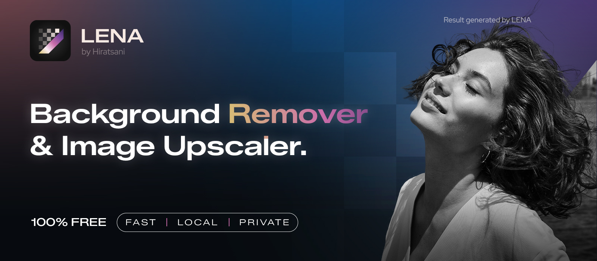

<p align="center">
  
</p>

# LENA

Free, open-source image tools for Windows. Remove backgrounds and upscale images locally on your PC.

**No account · No image uploads · No usage limits**

[](https://github.com/hiratsani/LENA-BG-Removal-Upscaler/releases/download/v1.0.0/LENA-Setup.exe)
[](LICENSE)

**Windows 10 / 11 · 64-bit · v1.0.0**

[Website](https://hiratsani.github.io/LENA-BG-Removal-Upscaler/) · [Application source](app/) · [Releases](https://github.com/hiratsani/LENA-BG-Removal-Upscaler/releases) · [Issues](https://github.com/hiratsani/LENA-BG-Removal-Upscaler/issues)

## What LENA does

| Tool | Options |
| --- | --- |
| Background removal | Basic, Better, or Best quality for different subjects |
| Hair & Fur | Optional boundary refinement, powered by ViTMatte |
| Image upscaling | 2× or 4×, powered by SPAN |
| Export | PNG with transparency, or JPG |
| Interface | Light/dark themes and English/Indonesian |

Basic removal, Hair & Fur, and SPAN models are included in the installer and work offline immediately. Better and Best are optional one-time downloads inside the app; after downloading, they also work offline.

LENA processes your images on your computer. Your photos are not uploaded to a server. Enable Hair & Fur when hair or fur is visible in your image.

## Get started

1. Download **LENA-Setup.exe** from the [latest release](https://github.com/hiratsani/LENA-BG-Removal-Upscaler/releases/latest).
2. Install LENA, then open it and choose your image.
3. Remove the background or upscale, preview the result, and save.

Use Windows 10 version 1903 or newer, or Windows 11, with a 64-bit CPU and enough storage for the app and models. Processing time depends on your hardware, image size, and selected quality. The current pinned model policy uses CPU inference; see the [inference policy](app/GPU-AUDIT.md).

> Windows SmartScreen may show an “Unknown Publisher” warning because the installer is distributed without a code-signing certificate. Download from this repository's official release assets.

## Run or build from source

The complete current desktop source is in **[app/](app/)**. See its [setup, build, and test instructions](app/README.md).

```text
app/                 Desktop app, UI assets, model manifest, tests and build scripts
index.html           Landing page
site.css / site.js   Landing page styling and motion
assets/              Website assets and font license files
LICENSE              MIT license for original LENA code
```

Model weights, generated executables, local settings, logs and development environments are excluded from Git. `app/prepare_models.py` fetches the three offline models from pinned upstream URLs and checks their size and SHA-256 before use.

## License and credits

LENA's original application and website code are licensed under [MIT](LICENSE). Third-party models, fonts and dependencies keep their own licenses; see the [model guide](app/MODEL-GUIDE.md), `app/licenses/`, font license files, and [third-party notices](app/THIRD-PARTY-NOTICES.txt).

Made by **Hiratsani**.
